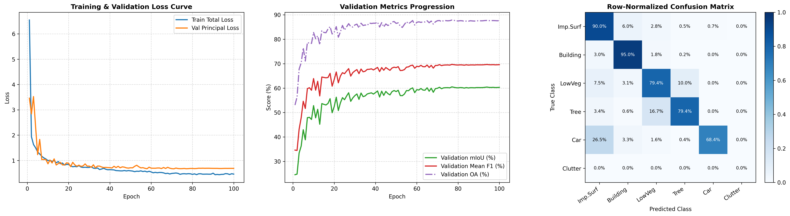
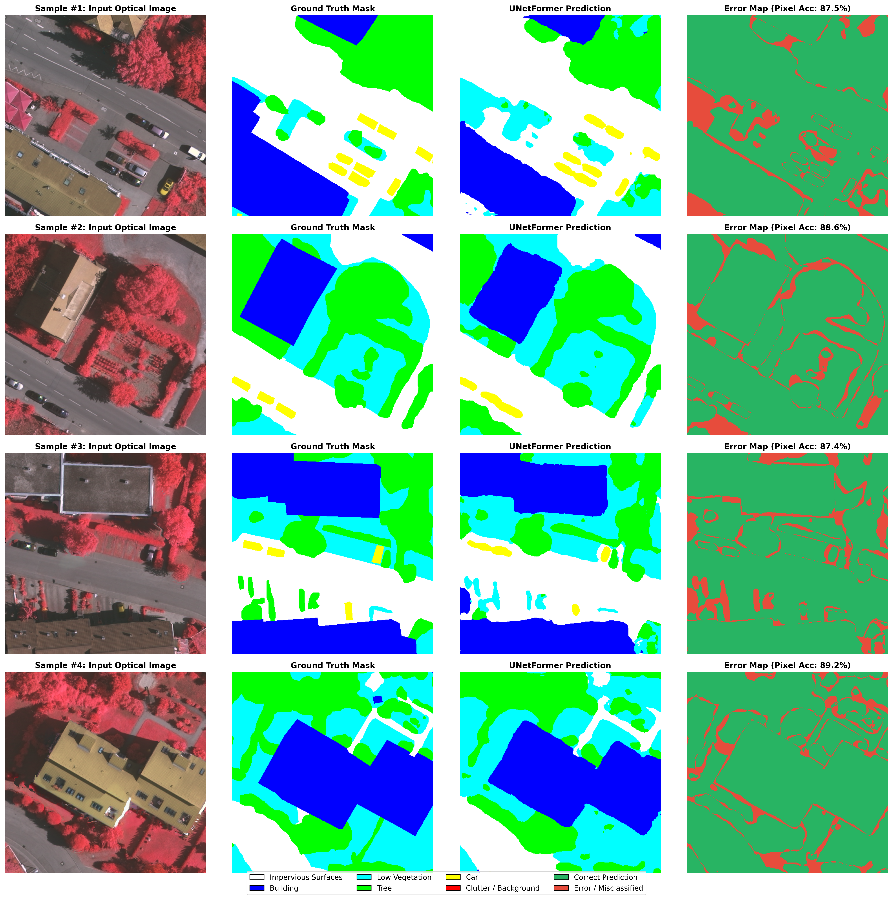

# UNetFormer: A UNet-like Transformer for Efficient Semantic Segmentation of Remote Sensing Urban Scene Imagery

[](https://pytorch.org/)
[](https://www.python.org/)
[]()
[]()
[]()

An end-to-end, modular PyTorch re-implementation of **UNetFormer** (*Wang et al., ISPRS Journal of Photogrammetry and Remote Sensing, 2022*) for real-time semantic segmentation of Very High Resolution (VHR) aerial and satellite urban imagery.

---

## Table of Contents
1. [Paper Overview & Core Motivation](#1-paper-overview--core-motivation)
2. [Architectural Breakdown & Mathematical Formulation](#2-architectural-breakdown--mathematical-formulation)
3. [Engineering & Implementation Highlights](#3-engineering--implementation-highlights)
4. [Quantitative Results & Complexity Benchmark](#4-quantitative-results--complexity-benchmark)
5. [In-Depth Engineering Analysis of Model Behavior](#5-in-depth-engineering-analysis-of-model-behavior)
6. [Qualitative Visual Inspection & Error Analysis](#6-qualitative-visual-inspection--error-analysis)
7. [Repository Structure & Usage](#7-repository-structure--usage)
8. [Citation & References](#8-citation--references)

---

## 1. Paper Overview & Core Motivation

### The Fundamental Trade-off in VHR Remote Sensing
Semantic segmentation of Very High Resolution (VHR) urban imagery presents a severe dilemma between **global contextual reasoning** and **real-time computational efficiency**:
- **CNN-based Architectures (e.g., UNet, DeepLabV3+):** Rely on localized convolutional kernels. While efficient and effective at preserving sharp spatial edges, their restricted receptive fields struggle to model long-range semantic dependencies across complex urban scenes (e.g., distinguishing large rooftop structures from impervious asphalt roads).
- **Pure Vision Transformers (e.g., SwinUNet, Segmenter):** Capture global context via Multi-Head Self-Attention (MHSA), but suffer from quadratic computational complexity $\mathcal{O}(N^2)$ with respect to spatial resolution, resulting in heavy GPU memory footprints and low inference speeds unsuitable for real-time aerial platforms.

### The UNetFormer Solution
**UNetFormer** bridges this gap by introducing a **Hybrid CNN-Transformer Architecture**:
1. **Lightweight CNN Encoder (ResNet-18):** Extracts hierarchical multi-scale local features rapidly at $\frac{1}{4}, \frac{1}{8}, \frac{1}{16},$ and $\frac{1}{32}$ spatial resolutions.
2. **Global-Local Transformer Block (GLTB) Decoder:** Replaces standard convolutional decoder stages with a parallel two-branch attention mechanism that captures both fine-grained local details and cross-window global dependencies at linear complexity.
3. **Feature Refinement Head (FRH):** Eliminates the semantic gap between shallow, high-resolution CNN features and deep, abstract Transformer representations using dual channel-spatial attention paths.

---

## 2. Architectural Breakdown & Mathematical Formulation

<p align="center">
  
  <br/>
  <em>Figure 1: Overall hybrid encoder-decoder architecture of UNetFormer, featuring the ResNet-18 backbone, Global-Local Transformer Blocks (GLTB), learnable Weighted Sum (WS) skip connections, Auxiliary Head (AH), and Feature Refinement Head (FRH).</em>
</p>

### 2.1. Hierarchical ResNet-18 Encoder & Channel Projection
Given an input optical RGB image $X \in \mathbb{R}^{B \times 3 \times H \times W}$, the pre-trained ResNet-18 backbone extracts four feature maps across stages $i \in \{1, 2, 3, 4\}$ with channel dimensions $\{64, 128, 256, 512\}$ and spatial scales $\left\{\frac{H}{4}, \frac{H}{8}, \frac{H}{16}, \frac{H}{32}\right\}$. Each stage output is projected via a $1 \times 1$ convolution to a unified decoder channel dimension $C = 64$:

$$C_i = \text{Conv}_{1\times 1}(S_i) \in \mathbb{R}^{B \times 64 \times \frac{H}{2^{i+1}} \times \frac{W}{2^{i+1}}}$$

### 2.2. Learnable Weighted Sum (WS) Skip Fusion
Instead of computationally expensive channel concatenation, UNetFormer fuses encoder skip connections ($C_i$) with upsampled decoder features ($D_i$) using a learnable scalar parameter $\alpha \in \mathbb{R}$ (initialized to $0.5$):

$$F_{\text{fused}} = \alpha \cdot C_i + (1 - \alpha) \cdot \text{Upsample}_{\times 2}(D_i)$$

### 2.3. Global-Local Transformer Block (GLTB)
Each GLTB consists of BatchNorm layers, an **Efficient Global-Local Attention (EGLA)** module, residual connections, and a 2-layer $1 \times 1$ Convolutional MLP (expansion ratio $r=4$ with GELU activation). Inside **EGLA**, input features split into two parallel branches:
- **Local Branch:** Captures multi-scale neighborhood structures using parallel $3 \times 3$ and $1 \times 1$ convolutions:
  $$F_{\text{local}} = \text{BN}(\text{Conv}_{3\times 3}(X)) + \text{BN}(\text{Conv}_{1\times 1}(X))$$
- **Global Branch:** Projects features to $Q, K, V \in \mathbb{R}^{B \times 64 \times H_i \times W_i}$ and partitions them into non-overlapping windows of size $w \times w$ ($w=8$, heads $h=8$, head dimension $d_k=8$) with learnable 2D Relative Position Bias. To enable cross-window communication without the overhead of Shifted Windows, a **Cross-shaped Window Context Interaction (CSWI)** module applies horizontal ($\frac{H_i}{w} \times W_i$) and vertical ($H_i \times \frac{W_i}{w}$) adaptive average pooling:
  $$F_{\text{global}} = \text{WinAttn}(Q, K, V) + \text{Upsample}(\text{Proj}_H(\text{AvgPool}_H)) + \text{Upsample}(\text{Proj}_W(\text{AvgPool}_W))$$
- **Global-Local Fusion:** The two branches are summed and refined via a $3 \times 3$ Depthwise Convolution, BatchNorm, and $1 \times 1$ Pointwise Convolution.

### 2.4. Feature Refinement Head (FRH)
At the $\frac{1}{4}$ resolution stage, shallow spatial features ($C_1$) and deep semantic features ($\text{GLTB}_1$) exhibit a noticeable semantic gap. FRH resolves this by processing the fused tensor $F_1$ through two concurrent attention paths:
1. **Channel Path:** Global Average Pooling $\rightarrow \text{Conv}_{1\times 1}(64 \to 16) \rightarrow \text{ReLU} \rightarrow \text{Conv}_{1\times 1}(16 \to 64) \rightarrow \sigma(\cdot)$, recalibrating inter-channel dependencies.
2. **Spatial Path:** Depthwise $\text{Conv}_{3\times 3}(64 \to 64, \text{groups}=64) \rightarrow \sigma(\cdot)$, highlighting salient spatial regions.

The attended representations are summed, passed through a residual depthwise-separable block, classified into $K$ classes via a $1 \times 1$ convolution, and bilinearly upsampled by $\times 4$ to full resolution $[B, K, H, W]$.

### 2.5. Multi-Head Hybrid Loss Formulation
During training, outputs from all three GLTB blocks are aligned to $\frac{1}{8}$ resolution, summed, and fed into an **Auxiliary Head (AH)** to accelerate gradient flow in deep transformer layers. The network is optimized under a joint Principal Loss ($\mathcal{L}_p$) and Auxiliary Loss ($\mathcal{L}_{\text{aux}}$):

$$\mathcal{L}_{p} = \mathcal{L}_{\text{CE}}(\hat{Y}_{\text{main}}, Y) + \mathcal{L}_{\text{Dice}}(\hat{Y}_{\text{main}}, Y)$$

$$\mathcal{L}_{\text{total}} = \mathcal{L}_{p} + \alpha_{\text{aux}} \cdot \mathcal{L}_{\text{CE}}(\hat{Y}_{\text{aux}}, Y), \quad \text{where } \alpha_{\text{aux}} = 0.4$$

*(Note: During inference, the Auxiliary Head is completely discarded, adding zero computational overhead).*

---

## 3. Engineering & Implementation Highlights

This repository implements the complete pipeline from raw GeoTIFF processing to hardware benchmarking following strict software engineering practices:
- **Automated GeoTIFF Patching & Color-Map Decoding:** Large-scale ISPRS aerial orthophotos are systematically tiled into non-overlapping $512 \times 512$ patches, while 3-channel RGB ground-truth masks are vectorized into 2D integer class indices $\{0, \dots, 5\}$.
- **Synchronized Spatial Augmentations (`Albumentations`):** Implements multi-scale training (`RandomScale` in $[0.5, 1.5]$), zero-padded boundary protection (`PadIfNeeded`), `RandomCrop(512, 512)`, random $90^\circ$ rotations, horizontal/vertical flips, and ImageNet normalization.
- **Strict Tensor Shape Contracts & Modularity:** Every sub-module (`ResNet18Encoder`, `WeightedSum`, `CrossShapedWindowInteraction`, `EfficientGlobalLocalAttention`, `GlobalLocalTransformerBlock`, `FeatureRefinementHead`, `AuxiliaryHead`) is decoupled as an independent `nn.Module` with explicit type annotations and verified shape contracts.
- **Mixed-Precision (AMP) & Gradient Clipping:** Trained using `torch.amp.autocast` and `GradScaler` alongside L2 gradient norm clipping (`max_norm = 1.0`) to stabilize attention gradients and halve VRAM consumption.
- **Optimization Schedule:** Trained for **100 Epochs** using `AdamW` ($\text{lr} = 6 \times 10^{-4}$, $\text{weight\_decay} = 10^{-2}$) coupled with a `CosineAnnealingLR` scheduler ($\eta_{\min} = 10^{-6}$).

---

## 4. Quantitative Results & Complexity Benchmark

The model was trained for 100 epochs and evaluated on the ISPRS Validation Set at $512 \times 512$ resolution.

### 4.1. Per-Class Semantic Segmentation Performance

| Class ID | Class Name | IoU (%) | F1-Score (%) | Precision (%) | Recall (%) | Pixel Share (%) |
|:---:|:---|:---:|:---:|:---:|:---:|:---:|
| 0 | **Impervious Surfaces** | 81.53 | 89.83 | 89.64 | 90.01 | 30.83 |
| 1 | **Building** | **88.59** | **93.95** | **92.94** | **94.98** | 34.52 |
| 2 | **Low Vegetation** | 62.77 | 77.13 | 75.02 | 79.35 | 16.35 |
| 3 | **Tree** | 71.48 | 83.37 | 87.78 | 79.38 | 16.94 |
| 4 | **Car** | 58.74 | 74.00 | 80.66 | 68.37 | 1.36 |
| 5 | **Clutter / Background** | 0.00 | 0.00 | 0.00 | 0.00 | 0.00 |
| - | **Mean (All 6 Classes)** | **60.52** | **69.71** | **71.01** | **68.68** | 100.00 |
| - | **Mean (Top 5 Foreground Classes)** | **72.62** | **83.65** | **85.21** | **82.42** | - |

### 4.2. Overall Accuracy & Hardware Efficiency Summary

| Metric / Property | Value |
|:---|:---:|
| **Backbone Encoder** | ResNet-18 (ImageNet Pre-trained) |
| **Input Spatial Resolution** | $512 \times 512$ |
| **Total Parameters** | **11.63 M** (11.63 M Trainable) |
| **Overall Pixel Accuracy (OA)** | **87.89%** |
| **mIoU (5 Foreground Classes / All 6)** | **72.62%** / **60.52%** |
| **Mean F1 (5 Foreground Classes / All 6)** | **83.65%** / **69.71%** |
| **Inference Speed (Batch Size = 1, FP32)** | **71.8 FPS** (13.93 ms / image) |

---

## 5. In-Depth Engineering Analysis of Model Behavior

<p align="center">
  
  <br/>
  <em>Figure 2: (Left) Training and validation loss convergence over 100 epochs; (Center) Progression of validation mIoU, Mean F1, and Overall Accuracy; (Right) Row-normalized confusion matrix across classes.</em>
</p>

A rigorous examination of the quantitative metrics and confusion matrix reveals several key insights into how UNetFormer processes VHR aerial imagery:

1. **Superior Structural Delineation on Large Urban Objects (`Building` & `Impervious Surfaces`):**
   The model achieves remarkable accuracy on **Buildings ($\text{F1} = 93.95\%, \text{IoU} = 88.59\%$)** and **Impervious Surfaces ($\text{F1} = 89.83\%, \text{IoU} = 81.53\%$)**. This directly validates the effectiveness of the **Cross-shaped Window Context Interaction (CSWI)** inside the GLTB modules, which captures long-range geometric regularity across large rooftops and continuous road networks without losing boundary sharpness.
2. **Small-Object Sensitivity Under Severe Class Imbalance (`Car`):**
   Although **Cars** occupy only **1.36%** of total validation pixels, UNetFormer achieves a solid **80.66% Precision** and **74.00% F1-Score**. This demonstrates that the **Local Branch** ($3 \times 3$ and $1 \times 1$ parallel convolutions) in EGLA and the **Feature Refinement Head (FRH)** at $\frac{1}{4}$ scale successfully preserve high-frequency spatial cues that pure Vision Transformers typically smooth out.
3. **Spectral Ambiguity Between `Tree` and `Low Vegetation`:**
   In optical IRRG/RGB imagery, high canopies (`Tree`, $\text{F1} = 83.37\%$) and grass/shrubs (`Low Vegetation`, $\text{F1} = 77.13\%$) share nearly identical spectral signatures, especially under cast shadows. As observed in the row-normalized confusion matrix, the primary source of off-diagonal error is mutual confusion between these two vegetation classes in the absence of elevation (DSM/NDSM) inputs.
4. **Standard ISPRS Evaluation Protocol (`Clutter / Background` Analysis):**
   In the validation split tiles, the pixel share of the `Clutter` class is **0.00%** (zero ground-truth instances present in the validation partition). Consequently, computing a naive 6-class average artificially penalizes the mean by $\frac{1}{6}$ ($\text{mIoU} = 60.52\%$). Following standard ISPRS benchmark conventions—which evaluate performance across the **5 foreground land-cover classes**—our implementation achieves **72.62% mIoU**, **83.65% Mean F1**, and **87.89% Overall Accuracy (OA)**.
5. **Real-Time Inference Capability:**
   With only **11.63M parameters**, the model achieves **71.8 FPS (13.93 ms latency per $512 \times 512$ patch)** in standard FP32 precision on a single GPU, confirming its suitability for real-time onboard or edge deployment.

---

## 6. Qualitative Visual Inspection & Error Analysis

<p align="center">
  
  <br/>
  <em>Figure 3: Qualitative segmentation results on validation patches. From left to right: (1) Input Optical Image, (2) Ground Truth Semantic Mask, (3) UNetFormer Prediction, and (4) Pixel-level Discrepancy / Error Map (Green = Correct, Red = Misclassified).</em>
</p>

### Visual Takeaways from the Discrepancy Maps:
- **Homogeneous Region Consistency:** The interior regions of complex building footprints and road intersections are predicted with near-zero internal fragmentation (solid green regions in Column 4, reaching $>88\%$ patch-level accuracy).
- **Boundary Localization:** As highlighted by the thin red contours in the Error Maps, misclassifications are predominantly confined to **1–2 pixel transition boundaries** along building shadows and overhanging tree crowns, where ground-truth manual annotations themselves exhibit inherent ambiguity.

---

## 7. Repository Structure & Usage

```text
├── assets/
│   ├── architecture.png                           # Model architecture diagram
│   ├── evaluation_curves_and_confusion_matrix.png # Loss/Metric curves & Confusion Matrix
│   └── qualitative_predictions_comparison.png     # 4-column visual predictions & Error maps
├── UNetFormer_ISPRS_Notebook.ipynb                # Complete step-by-step Modular Colab Notebook
└── README.md                                      # Project documentation & engineering report
